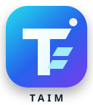

<div align="center">



# Taim

**A GPU-native, fine-grained reactive GUI framework for Rust.**
One codebase for macOS, Windows, Linux, Android, iOS and the web.

[](https://www.rust-lang.org)
[](LICENSE)
[](docs/performance/numbers.md#quality)
[](#platforms)
[](CHANGELOG.md)

</div>

```rust
use taim::prelude::*;

fn main() -> taim::Result {
    taim::launch("Counter", |cx| {
        let count = cx.signal(0_i64);

        column(views![
            text(move || format!("Count: {}", count.get())).size(32),
            row(views![
                button("−1").on_press(move || count.update(|n| *n -= 1)),
                button("+1").on_press(move || count.update(|n| *n += 1)),
            ])
            .gap(8.0),
        ])
        .gap(16.0)
        .padding(24.0)
    })
}
```

No message enum. No `update` function. No virtual DOM. The build closure
runs **once**; when `count` changes, only the one `text` that reads it is
laid out and painted again.

---

## By the numbers

Every figure links to how it was measured. See
[docs/performance/numbers.md](docs/performance/numbers.md) for the raw data,
the hardware and what each number does and does not include.

| | |
|---|---|
| **57.6 µs** | p95 framework cost per frame scrolling a **100,000-row** list, ~1/145 of a 120 Hz frame budget ([data](docs/performance/numbers.md#frame-cost)) |
| **6.5 µs** | p95 framework cost of an idle frame ([data](docs/performance/numbers.md#frame-cost)) |
| **0** | dropped frames across 13 stress scenes × 5 runs × 180 frames ([data](docs/performance/numbers.md#frame-cost)) |
| **~24 KiB** | live heap left at the end of every scene, the same in all 5 runs: no leaks under load ([data](docs/performance/numbers.md#memory)) |
| **3.58 MiB** | stripped release binary of a complete app on macOS; 4.00 MiB on iOS, 2.07 MiB gzipped ([data](docs/performance/numbers.md#binary-size)) |
| **21 ns** | to broadcast an event with no listeners; 108 ns to one, with zero allocations ([data](docs/performance/numbers.md#runtime-microbenchmarks)) |
| **2,534** | tests passing in the release gate, plus 3 browsers and 11 build targets linted with warnings denied ([data](docs/performance/numbers.md#quality)) |
| **14 / 14** | release-gate steps passing, none skipped ([gate](docs/release/production-gates.md)) |

## Why Taim

**Fine-grained reactivity, not re-rendering.** State lives in `Copy`
handles (`cx.signal(..)`) that you move into closures and change from any
thread. Views that read a handle subscribe to it; nothing else is touched
when it changes. An unchanged window does no work.

**GPU-native rendering.** wgpu on Metal, Vulkan, DirectX 12 and WebGL2,
with linear-light compositing, analytic anti-aliasing, a generational glyph
and image atlas, and a pipeline cache. A software renderer (tiny-skia)
takes over automatically when there is no GPU.

**Liquid glass.** `glass(view)` frosts, lenses and lights what is behind
it, with a rainbow fringe at the rounded edge. Panes in a `glass_group`
melt into one another. It falls back to a tinted surface without a GPU or
with "reduce transparency" on. [Read more](docs/design/liquid-glass.md).

**Mobile-grade interaction.** A gesture arena resolves taps, drags,
flings, pinches and edge swipes between nested views. Springs keep their
velocity when interrupted. A navigator with interactive swipe-back, hero
transitions between screens, bottom sheets with detents, pull-to-refresh
and an edge-swipe drawer come built in.

**Accessible by design.** Every view describes itself in a semantic tree
(roles, labels, values, focus and live announcements) that reaches
TalkBack on Android and, with the `accessibility` feature, Orca on Linux
through AT-SPI. VoiceOver and Narrator
bridges are on the 1.0 list.

**Ships to stores.** `taim-new` writes a project that builds for the
desktop and as an Android library, with packagers for
[Google Play, the App Store, the Mac App Store, the Microsoft Store and the
Snap Store](docs/release/store-submission.md).

## Get started

Taim is not yet on crates.io. Clone it and create a project next to it:

```bash
git clone https://github.com/theaimartco/taim.git && cd taim
cargo run -p gallery                     # every view, light and dark
cargo run -p taim-new -- ../hello        # your own app
cd ../hello && cargo run
```

Or depend on the repository:

```toml
[dependencies]
taim = { git = "https://github.com/theaimartco/taim" }
```

Then read the [getting-started guide](docs/guide/getting-started.md): state,
layout, lists, navigation, background work, storage and glass in ten short
sections. Every example in it is compiled by the test suite.

## A taste of the API

**Lists that follow state.** `each` keeps one row per item; `list` builds
only the rows on screen, for any number of them.

```rust
each(todos, |todo: &Todo| text(todo.title.clone()))

list(move || messages.with(Vec::len), move |index| {
    text(move || messages.with(|all| all[index].subject.clone())).into()
})
```

**Screens and back.**

```rust
let nav = Navigator::new(cx, Route::Inbox);
navigator(nav, move |_cx, route| match route {
    Route::Inbox => button("Open").on_press(move || nav.push(Route::Message(7))).into(),
    Route::Message(id) => text(format!("Message {id}")).into(),
})
```

**Background work that updates the UI.**

```rust
let tasks = cx.tasks();
button("Load").on_press(move || {
    tasks.spawn(async move { status.set(fetch().await) });
})
```

**Settings that survive crashes, and the platform.**

```rust
let mut settings = taim::storage::Store::open("settings")?;
settings.set("theme", "dark")?;
taim::platform::share_text("Made with Taim")?;
```

## Views

56 views ship in `taim::prelude`:

| Area | Views |
|---|---|
| Layout | `column` `row` `grid` `layers` `container` `space` `rule` `scroll` `list` `each` `when` `rebuild` |
| Text & input | `text` `text_field` `text_editor` `search` `button` `icon_button` `checkbox` `radio` `switch` `slider` `stepper` `segmented` `chip` `dropdown` |
| Pickers | `date_picker` `time_picker` |
| App structure | `scaffold` `app_bar` `nav_bar` `tabs` `navigator` `drawer` `sheet` `dialog` `snackbar` `tooltip` `accordion` `carousel` |
| Display | `icon` `image` `svg` `avatar` `badge` `progress` `skeleton` `list_tile` |
| Motion & touch | `animated` `appear` `hero` `pinch` `pull_to_refresh` `mouse_area` |
| Material | `glass` `glass_group` |

On Android, native maps, video, camera previews and web views embed as
views too. Run `cargo run -p gallery` to try them all.

## Platforms

| Platform | Renderer | State |
|---|---|---|
| macOS (arm64) | Metal | Runs; sandboxed release app verified on hardware |
| Linux (X11, Wayland) | Vulkan, GL | Runs; tested under a virtual display |
| Web (WebAssembly) | WebGL2 | Runs in Chromium, Firefox and WebKit in the release gate |
| Android (arm64, x86_64) | Vulkan, GLES | Builds and links; device testing in progress |
| iOS (arm64) | Metal | Builds and lints; device testing in progress |
| Windows (x64, arm64) | DirectX 12, Vulkan | Builds and lints; hardware testing in progress |

All 11 targets (x86_64 and arm64 where they exist) are built and linted
with warnings denied on every release check.

## Examples

| Command | What it shows |
|---|---|
| `cargo run -p counter` | The smallest app |
| `cargo run -p todos` | Lists, conditional views, background work |
| `cargo run -p gallery` | Every view, light and dark |
| `cargo run -p mobile_shell` | Tabs, nav bar, drawer, sheet, pull-to-refresh; also runs on Android |
| `cargo run -p liquid` | Liquid glass over a scrolling feed |
| `cargo run -p ide` | A code editor with syntax highlighting and a terminal |

## Documentation

| | |
|---|---|
| [Getting started](docs/guide/getting-started.md) | From install to a running app |
| [Numbers](docs/performance/numbers.md) | Every measurement, with hardware and method |
| [Platforms](docs/platform/) | Android, iOS, macOS, web specifics |
| [Store submission](docs/release/store-submission.md) | Packaging for five app stores |
| [Architecture](docs/architecture/) | Signals, layout, rendering, input, text |
| [Liquid glass](docs/design/liquid-glass.md) | How the material works |
| [Release gates](docs/release/production-gates.md) | What every release must pass |
| [All docs](docs/README.md) | The full index |

## Architecture

```text
 your app ─ taim (launch, storage, platform)
             │
             ├─ taim-view ─────── views, layout, events, accessibility
             │    └─ taim-signal   fine-grained, thread-safe state
             ├─ taim_winit ────── windows, input, IME, Android/iOS hosts
             ├─ taim_renderer
             │    ├─ taim_wgpu      GPU: Metal · Vulkan · DX12 · WebGL2
             │    └─ taim_tiny_skia CPU fallback
             └─ taim-gesture · taim-motion · taim-accessibility · taim_atlas · taim_text_gpu
```

27 crates and 246,000 lines of library Rust. `unsafe_code` is denied by
default; it appears only in the Android and Apple hosts, GPU interop, the
image cache's allocator and development-only hot reload.

## Status

0.15.0-rc.1 is a **release candidate**. The release gate (formatting,
lints on every target, 2,534 tests, a new-project build, an external
consumer build, a dependency and license audit, browser tests in three
engines and an Android link) passes in full. Before 1.0 we are completing
testing on physical Android phones, iPhones, Windows PCs and Wayland
desktops, VoiceOver and Narrator support, screen-reader passes and power
measurements. Progress is tracked
in [production gates](docs/release/production-gates.md) and the
[changelog](CHANGELOG.md).

The public API may still change before 1.0; the changelog marks every
breaking change.

## Credits and license

MIT. Taim's widget and renderer engine began as a fork of
[Iced](https://github.com/iced-rs/iced); see [CREDITS.md](CREDITS.md).

## Sponsor

If Taim is useful to you, you can support its development:
[rzp.io/rzp/theaimart-taimrs](https://rzp.io/rzp/theaimart-taimrs).
