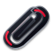
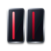
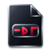

# TAIM Premium SVG Pack · Edition 03

**119 individually named and editable SVG icons**, transparent 64×64 viewport, actual vector paths and native gradients—not PNG files renamed to SVG. Every premium source is also exposed byte-identically in `assets/icons/<name>.svg`.

This edition converts **all 24 previous monochrome-only root SVG names** to new TAIM-style vector artwork and adds **35 entirely new icons**. It does not delete useful legacy filenames or break consumers of those paths. The 36 icon-font glyph codepoints remain available separately for backward compatibility, and must not be misrepresented as independently re-authored by this asset change.

## Gallery

[Open the gallery](./gallery.html) to browse/filter all 119 symbols.

| Icon | Icon | Icon | Icon | Icon |
|:---:|:---:|:---:|:---:|:---:|
|<br>add|<br>archive|<br>arrow_down|<br>arrow_left|<br>arrow_right|
|<br>arrow_up|<br>attachment|<br>backspace|<br>battery|<br>battery_charging|
|<br>bluetooth|<br>bookmark|<br>calendar|<br>camera|<br>chart|
|<br>chat|<br>check|<br>checkbox_checked|<br>checkbox_unchecked|<br>chevron_down|
|<br>chevron_left|<br>chevron_right|<br>chevron_up|<br>clear|<br>clock|
|<br>close|<br>cloud|<br>code|<br>collapse|<br>copy|
|<br>cpu|<br>cut|<br>database|<br>delete|<br>document|
|<br>download|<br>edit|<br>error|<br>exit_fullscreen|<br>expand|
|<br>external_link|<br>filter|<br>folder|<br>folder_add|<br>folder_open|
|<br>fullscreen|<br>globe|<br>grid|<br>heart|<br>help|
|<br>history|<br>home|<br>image|<br>info|<br>keyboard|
|<br>link|<br>list|<br>lock|<br>mail|<br>maximize|
|<br>menu|<br>microphone|<br>microphone_off|<br>minimize|<br>monitor|
|<br>more_horiz|<br>more_vert|<br>mouse|<br>music|<br>notifications|
|<br>paste|<br>pause|<br>pdf|<br>person|<br>pin|
|<br>play|<br>power|<br>presentation|<br>printer|<br>progress|
|<br>qr_code|<br>radio_checked|<br>radio_unchecked|<br>redo|<br>refresh|
|<br>remove|<br>rocket|<br>save|<br>search|<br>settings|
|<br>share|<br>shield|<br>shopping_cart|<br>slider|<br>sort|
|<br>sort_ascending|<br>sort_descending|<br>sparkle|<br>spreadsheet|<br>star|
|<br>store|<br>success|<br>sync|<br>terminal|<br>toggle_off|
|<br>toggle_on|<br>trash|<br>undo|<br>unlink|<br>upload|
|<br>usb|<br>user|<br>visibility|<br>volume|<br>volume_off|
|<br>wallet|<br>warning|<br>wifi|<br>wifi_off|

## Files and integration

- `premium/<name>.svg`: original artwork, the single source of truth.
- `../<name>.svg`: identical root export for existing asset-path consumers.
- `manifest.json`: machine-readable list of 119 unique names.
- `scripts/assets/build-icon-font.py`: regenerates the font codepoints from existing glyph geometry but **no longer generates monochrome root SVGs**; it copies all 119 premium sources to `assets/icons/` instead.
- `scripts/assets/validate-premium-icons.py`: structure, manifest, root parity and security checks.

```bash
python3 scripts/assets/validate-premium-icons.py
bash scripts/design/check-icons.sh
```

**Visual QA outstanding**: review 16/24/32/64px readability, contrast on light/dark themes, keyboard/a11y labels, software/native SVG renderer support and export consistency. The existing `Taim-Icons.ttf` and Rust glyph constants are not replaced by vector-only additions. Preserve historical third-party credits.
