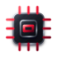
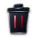
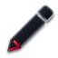
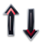

# TAIM Premium Icons — Editions 01 + 02

**60 native, standalone, editable vector SVG icons** — no raster image wrappers. Each uses a 64×64 transparent coordinate grid with polished graphite/chrome material and TAIM crimson gradients. Batch 02 UI-action icons have independently drawn paths and shapes; PNG previews are not embedded.

## Gallery

Browse all 60 in [gallery.html](./gallery.html), or see the actual SVG previews below.

### Edition 01 — System & application (30)

| Icon | Icon | Icon | Icon | Icon |
|:---:|:---:|:---:|:---:|:---:|
|<br>home|<br>settings|<br>folder|<br>search|<br>notifications|
|<br>user|<br>chat|<br>terminal|<br>store|<br>power|
|<br>lock|<br>shield|<br>calendar|<br>clock|<br>camera|
|<br>image|<br>music|<br>download|<br>upload|<br>cloud|
|<br>database|<br>cpu|<br>code|<br>rocket|<br>chart|
|<br>globe|<br>heart|<br>star|<br>trash|<br>edit|

### Edition 02 — UI actions (30)

| Icon | Icon | Icon | Icon | Icon |
|:---:|:---:|:---:|:---:|:---:|
|<br>save|<br>copy|<br>paste|<br>cut|<br>undo|
|<br>redo|<br>refresh|<br>sync|<br>share|<br>link|
|<br>unlink|<br>attachment|<br>bookmark|<br>pin|<br>sort|
|<br>sort_ascending|<br>sort_descending|<br>list|<br>grid|<br>expand|
|<br>collapse|<br>fullscreen|<br>exit_fullscreen|<br>maximize|<br>minimize|
|<br>backspace|<br>clear|<br>help|<br>external_link|<br>history|

## Usage and source of truth

```html


```

Both `assets/icons/<name>.svg` and `assets/icons/premium/<name>.svg` have identical source bytes. Premium files are authoritative; the font builder copies them to root after monochrome glyph regeneration.

The existing `graphics/fonts/Taim-Icons.ttf` and its 36 font codepoints are unchanged. All 30 Batch 02 additions are **SVG-only**, not automatically available as Rust `Icon` glyph constants. Widget integration requires additional work.

At 16px use simpler monochrome alternatives where these detailed bevels lose clarity; manually check visual contrast and accessibility.

## Verify

```bash
python3 scripts/assets/validate-premium-icons.py
bash scripts/design/check-icons.sh
```

MIT project licensing and historical third-party attribution are unchanged.
