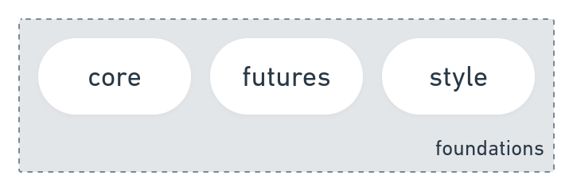

# `taim_core`
[][documentation]

`taim_core` holds basic reusable types of the public API. For instance, basic data types like `Point`, `Rectangle`, `Length`, etc.

This crate is meant to be a starting point for an Taim runtime.

  

[documentation]: https://docs.rs/taim_core
