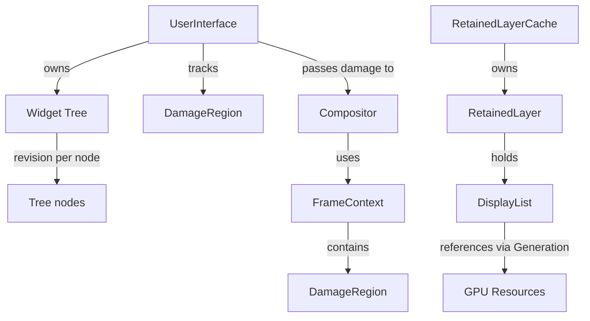
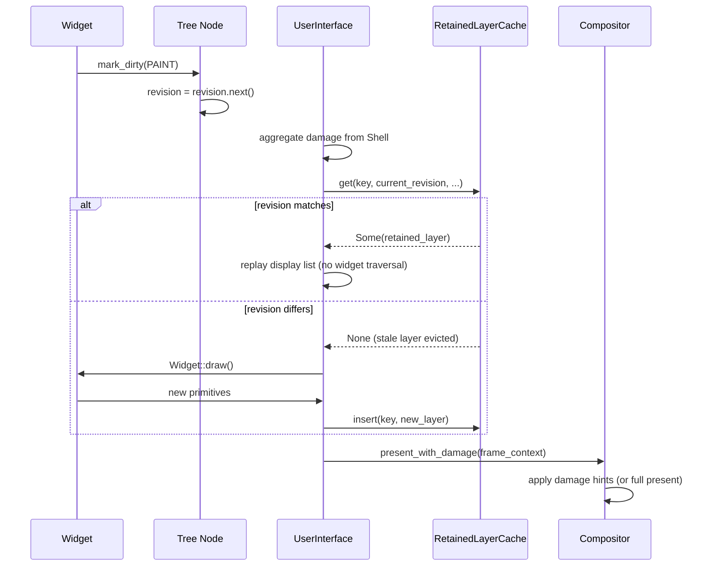

# Retained Rendering Architecture

> Phase 4 — Damage Tracking and Retained Layers

## Overview

The retained rendering system optimizes frame production by tracking
which parts of the UI have changed and skipping work for static
subtrees. Instead of rebuilding every primitive on every frame, the
system:

1. **Tracks damage** — records which rectangular regions of the surface
   need redrawing.
2. **Caches rendering output** — stores display lists (sequences of
   render commands) for widget subtrees that have not changed.
3. **Replays cached output** — when a subtree is unchanged, replays
   its display list instead of re-traversing the widget tree.

## Key Types

```
DamageRegion          (graphics/src/damage.rs)
├── SmallVec<[Rectangle; 8]> — inline storage for typical damage
├── clip_to_surface() — ensures damage stays within renderable area
├── expand_for_filter() — accounts for blur/shadow sampling radius
├── optimize() — merge adjacent rects, collapse to full if too much
└── add_movement() — damages both old and new bounds

DisplayList           (graphics/src/display_list.rs)
├── Arc<[Command]> — immutable, reference-counted command sequence
├── Generation — resource freshness stamp
└── DisplayListBuilder — accumulates commands, tracks bounds

RetainedLayer         (graphics/src/retained_layer.rs)
├── Revision — matches widget tree node's revision
├── clip/transform — rendering context when layer was built
├── DisplayList — the cached rendering output
└── is_valid() — checks revision, clip, transform, generation

RetainedLayerCache    (graphics/src/retained_layer.rs)
├── FxHashMap<RetainedLayerKey, RetainedLayer>
├── byte-bounded budget with LRU eviction
├── purge_stale_generations() — device-loss cleanup
└── CacheTelemetry — hit/miss/eviction counters

FrameContext          (graphics/src/compositor.rs)
├── damage: Option<DamageRegion> — partial present hint
├── scale_factor — HiDPI scaling
└── supports_partial_present() — readiness check

BoundedCache<K, V>    (graphics/src/cache.rs)
├── Generic byte-bounded LRU cache
├── Generation-based staleness detection
└── purge_stale() / purge_all() with telemetry
```

## Ownership Model



- **`UserInterface`** owns the widget tree and tracks damage regions
  across frames. It decides whether to rebuild a subtree or reuse a
  retained layer.
- **`RetainedLayerCache`** owns all retained layers. It is owned by
  whichever component manages the rendering pipeline (typically the
  runtime's window handler).
- **`DisplayList`** is `Arc`-shared between the retained layer cache
  and the active rendering pipeline. No deep copies occur.
- **GPU resources** (textures, buffers, shaped text) are referenced
  by `Generation` stamps, never by raw handles.

## Invalidation Flow



## Eviction Policy

The retained layer cache enforces a **byte budget** (default 64 MiB):

1. On `insert`: if adding the new layer would exceed the budget, the
   **least-recently-used** layer is evicted until there is room.
2. On `get` with stale revision: the stale layer is removed (does not
   count against the budget; the widget must rebuild anyway).
3. On `purge_stale_generations`: all layers referencing resources from
   an older generation are removed. This is called after device loss
   or atlas recreation.
4. On `purge`: all layers are removed (e.g. on theme change or
   scale factor change where every layer is invalid).

LRU eviction is O(n) in the worst case (linear scan of the map to
find the minimum `last_access_frame`). For typical UI layer counts
(<100), this is negligible. If profiling reveals it as a bottleneck
in pathological cases, a doubly-linked list can be added for O(1)
eviction.

## Fallback Strategy

The damage system is designed so that **falling back to a full present
is always correct**:

- If the damage region is `Full` → full present.
- If the damage region is unknown (`None`) → full present.
- If the backend does not support damage hints → full present.
- If too many scattered rects accumulate → collapse to `Full`.
- If total damage area exceeds 70% of the surface → collapse to `Full`.

This means the system can never produce visual artifacts from
under-damage. The worst case is a wasted opportunity to skip some
rendering work.

## Correctness Model

> **Invariant: damage is always conservative.**
>
> Overdraw (redrawing pixels that didn't change) is safe.
> Underdraw (failing to redraw pixels that did change) is a bug.

This is enforced by:
1. Movement damages both old and new bounds.
2. Filter effects expand damage by their sampling radius.
3. Non-finite coordinates collapse to full-surface damage.
4. Exceeding the rect count limit collapses to full-surface damage.
5. Every `DamageRegion` method preserves these invariants.

## Performance Characteristics

| Operation | Typical Cost | Notes |
|---|---|---|
| `add_rect` | O(1) | SmallVec inline push |
| `add_movement` | O(1) | Two `add_rect` calls |
| `clip_to_surface` | O(n) | n = number of rects |
| `expand_for_filter` | O(n) | In-place mutation |
| `optimize` | O(n log n) | Sort + greedy merge |
| Cache `get` (hit) | O(1) | HashMap lookup |
| Cache `get` (miss) | O(1) | HashMap lookup + remove |
| Cache `insert` | O(k) | k = evictions needed |
| `purge_stale_generations` | O(n) | Linear scan |

## Testing Strategy

- **Unit tests**: Each module has inline `#[cfg(test)]` tests for
  every public method.
- **Integration tests**: `tests/graphics/damage_region.rs` and
  `tests/graphics/retained_layers.rs` exercise the public API from
  a consumer's perspective.
- **Golden tests**: `tests/golden/damage_motion.rs` verifies damage
  correctness properties (no uncovered changed pixel).
- **Benchmark scene**: `tools/aura_bench/src/scenes/damage_churn.rs`
  measures performance under tiny, scattered, and full damage loads.
