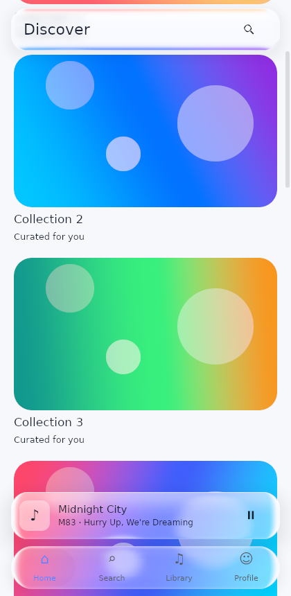

# Liquid glass



TAIM's glass is a material the GPU renderer shades per pixel. It is not a
blurred, semi-transparent rectangle.

| What you see | How it is made |
|---|---|
| The backdrop shows through, softly | The frame behind the pane is copied, a mip chain is built from it with a tent filter, and the pane reads the level that matches its frost radius, rounded off by a ring of taps. There is no grain or ghosting, at nine samples per pixel. |
| Colours behind the glass glow rather than grey out | A vibrance lift in linear light, scaled by the frost. |
| The rounded edge bends what is behind it | The bevel's normal comes from the pane's own signed distance field; the backdrop is displaced by the refraction through a slab of the material's thickness, scaled to the screen's density. |
| A faint rainbow at the rim | Each colour channel is refracted with its own index (dispersion). |
| A lit rim and a sheen across the top | A hairline highlight border, a specular term from the scene light, and a gradient fading out before the middle. |
| It floats | A soft shadow scaled by `elevation`. |
| A finger lights it and looks through it like a drop of water | A press is a second light just above the glass: the rim facing the finger catches it, a soft glow scatters in the body, and the backdrop under the finger is sampled closer to it, so it is seen magnified. |
| It swells, stretches and wobbles | Closed-form damped springs: a quick press with a little overshoot, a loose wobble back after a drag. The pane is a thicker lens while pressed. |
| Panes melt into each other | In a `glass_group`, each pane's shape is the smooth union of its own rounded rectangle and its nearest two neighbours', with the union's exact gradient, so the bridge has a continuous rim, bevel and refraction. Each point is drawn by its nearest pane only, so overlaps are never shaded twice. |
| The light moves | The scene light leans towards the pointer on a desktop and with the device's tilt on iOS (Core Motion, running only while glass is on screen). Tilt follows changes of attitude, not the angle the phone is held at. |
| Text on it stays readable | The backdrop's luminance under heavy frost decides how much of it the pane lets through: bright glass never falls below what black text needs for WCAG AA, and smoked glass never rises above what white text needs. |

## Using it

```rust
use taim::prelude::*;

layers(views![
    content,                                   // anything with colour and shape
    container(glass(text("Now playing")).radius(24.0)).align_bottom().padding(16.0),
])
```

- `glass(content)`: frosted liquid glass (`Material::LIQUID`).
- `.clear()`: almost no frost (`Material::LIQUID_CLEAR`), for small
  controls over busy content.
- `.tint(color)`, `.radius(r)`, `.padding(p)`, `.elevation(e)`,
  `.material(m)`, `.fill_width()`, `.fill()`.
- `.interactive()`: a control. As well as lighting and swelling under a
  press, it stretches after a dragging finger and wobbles back.
- `.still()`: answers no press at all.
- `glass_group(content).blend(px)`: the glass panes inside `content` melt
  into each other within `blend` logical pixels (16 by default). Exact for
  up to three panes that touch; keep scrolling content out of the group.

```rust
glass_group(
    row(views![
        glass(icon(Icon::CHEVRON_LEFT)).radius(27.0).clear().interactive(),
        glass(icon(Icon::PLAY)).radius(27.0).clear().interactive(),
        glass(icon(Icon::CHEVRON_RIGHT)).radius(27.0).clear().interactive(),
    ])
    .gap(12.0),
)
.blend(22.0)
```

With a gap a little wider than the blend, the controls stand apart at rest
and melt into their neighbours when one is pressed and swells.

With Reduce Motion on, a press still lights the glass, but nothing swells,
stretches, wobbles or follows the tilt.

Built-in surfaces use the same pane: the bottom navigation capsule
(`nav_bar`), dialogs and bottom sheets. `examples/liquid` puts all of
them over a scrolling feed: `cargo run -p liquid`.

## Rules the views follow

- Glass is drawn in a layer of its own (`View::is_layer`). The renderer
  copies the frame before that layer, so the glass sees everything painted
  earlier. A transmissive quad in the same layer as its content would see
  an empty frame.
- The fill is opaque: it is the tint, and the material's `transmission`
  sets how much backdrop shows through it. A translucent fill would let the
  sharp page show through as well as the frosted one.
- Light glass tints towards white; dark glass is smoked, with less
  transmission, so white text stays readable on it.
- Without a GPU (the tiny-skia renderer), glass is drawn as a solid tinted
  pane, which is also how platforms show glass when "reduce transparency"
  is on.

## Readable text

Secondary text (placeholders, inactive tabs and segments, the quiet days
of a date picker) fades towards the surface it sits on only as far as WCAG
AA allows: 4.5:1 for text and 3:1 for icons. `PaintCx::muted`,
`PaintCx::muted_on(surface)` and `PaintCx::quiet_icon_on(surface)` give
those colours, and a test holds them in every theme. Before this, those
labels read at 1.4 to 2:1.

## Testing

`tests/glass` renders glass on the GPU renderer and checks that the pane
shows the scene behind it, frosts fine detail, and falls back to a solid
pane on the CPU renderer. `tests/glass/live.rs` presses glass and checks
that it lights, swells and settles back exactly, that grouped panes bridge
when close and a pressed control melts into its neighbour, and that bright
glass over a dark backdrop stays bright enough for black text.
`TAIM_GLASS_OUT=<directory>` keeps the rendered images.

The liquid pass is its own quad pipeline (`wgpu/src/quad/liquid.rs`,
`shader/quad/liquid.wgsl`), so ordinary quads carry none of its data. It
uses 16 vertex attributes and 12 inter-stage variables, within the limits
of every adapter TAIM accepts, WebGL 2 included. It has been rendered on
Metal (macOS and the iOS Simulator); WebGL, Vulkan and DirectX have only
been compiled for, not rendered on, and device tilt has not been tried on a
physical iPhone. GPU tests need a Vulkan or GL adapter; on a
machine without a GPU install Mesa's software Vulkan driver
(`apt install mesa-vulkan-drivers`). Without an adapter they print
"skipped: no GPU adapter available" and pass, so check for that line
before treating a GPU test as run.
