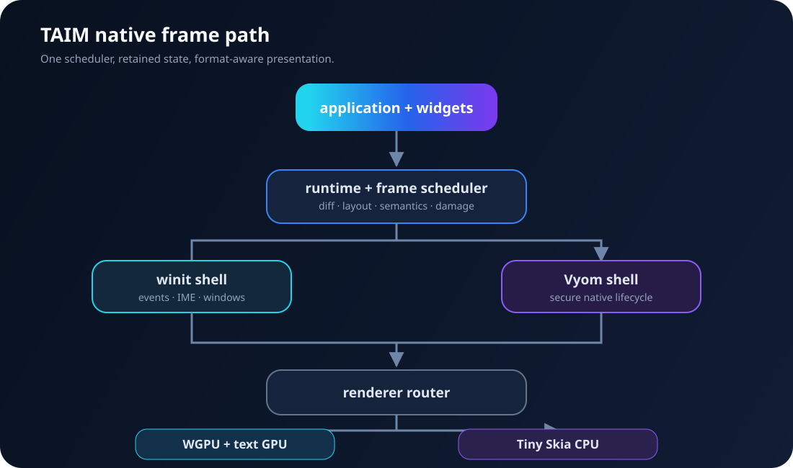

# `taim_wgpu`
[][documentation]

`taim_wgpu` is a [`wgpu`] renderer for [`taim_runtime`]. For now, it is the default renderer of Taim on [native platforms].

[`wgpu`] supports most modern graphics backends: Vulkan, Metal, DX12, OpenGL, and WebGPU.

  

[documentation]: https://docs.rs/taim_wgpu
[`taim_runtime`]: ../runtime
[`wgpu`]: https://github.com/gfx-rs/wgpu
[native platforms]: https://github.com/gfx-rs/wgpu#supported-platforms
[WebGPU API]: https://gpuweb.github.io/gpuweb/
[`wgpu_glyph`]: https://github.com/hecrj/wgpu_glyph
