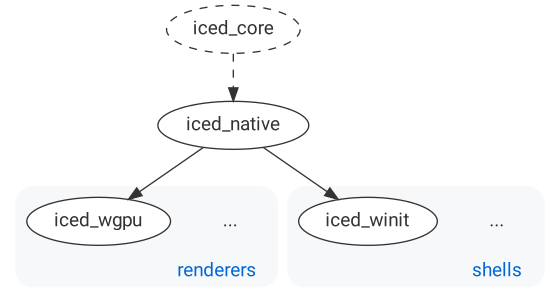

# `aura_winit`
[][documentation]

`aura_winit` offers some convenient abstractions on top of [`aura_native`] to quickstart development when using [`winit`].

It exposes a renderer-agnostic `Application` trait that can be implemented and then run with a simple call. The use of this trait is optional. A `conversion` module is provided for users that decide to implement a custom event loop.

  

[documentation]: https://docs.rs/aura_winit
[`aura_native`]: ../native
[`winit`]: https://github.com/rust-windowing/winit
